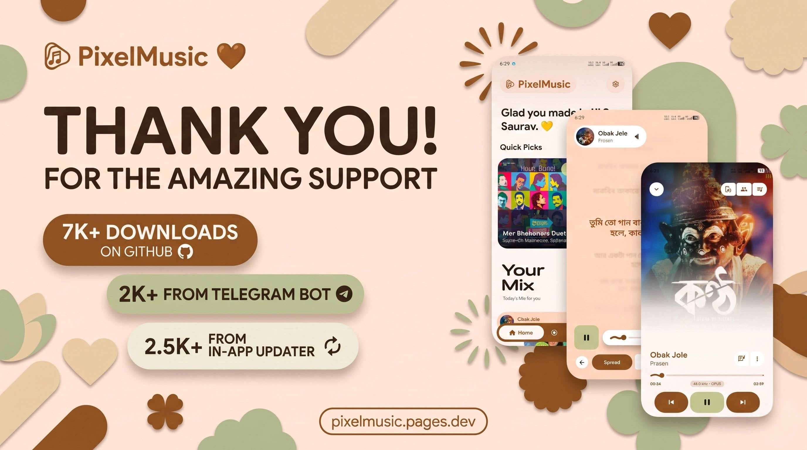
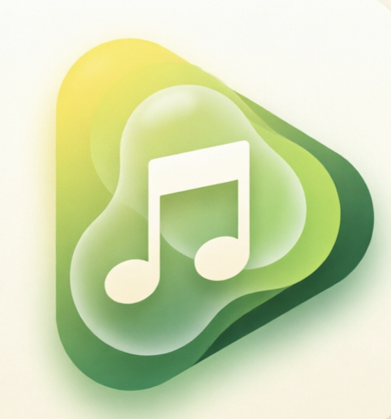

# 🎵 PixelMusic

### **The Next-Generation Material 3 Expressive Music Experience for Android**

*Engineered for audiophiles. Designed with fluid Material 3 Expressive motion. Crafted for uncompromised performance.*

---

> **📢 Official Source Code Repository Notice**
> This repository is exclusively dedicated to developing the **open-source codebase** of PixelMusic.
> If you are a new user, install the application from the official page or use the Telegram bot. The bot delivers app updates, bleeding-edge beta builds, and accepts user feedback directly!
>
> 🌐 **[Official Website (pixelmusic.pages.dev)](https://pixelmusic.pages.dev)** • 🤖 **[Telegram Update & Feedback Bot (@PixelMusicAppBot)](https://t.me/PixelMusicAppBot)**

---

## 📱 App Experience Showcase

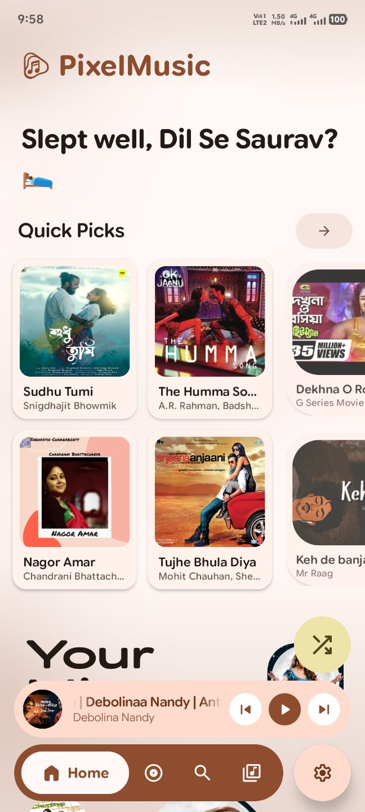

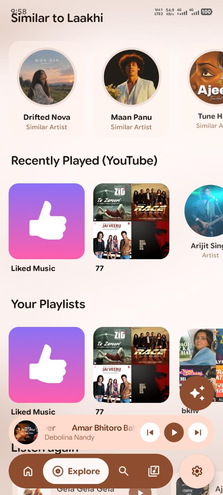

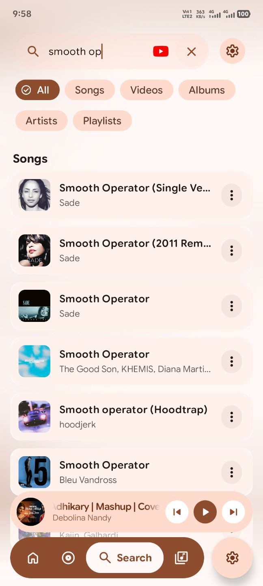

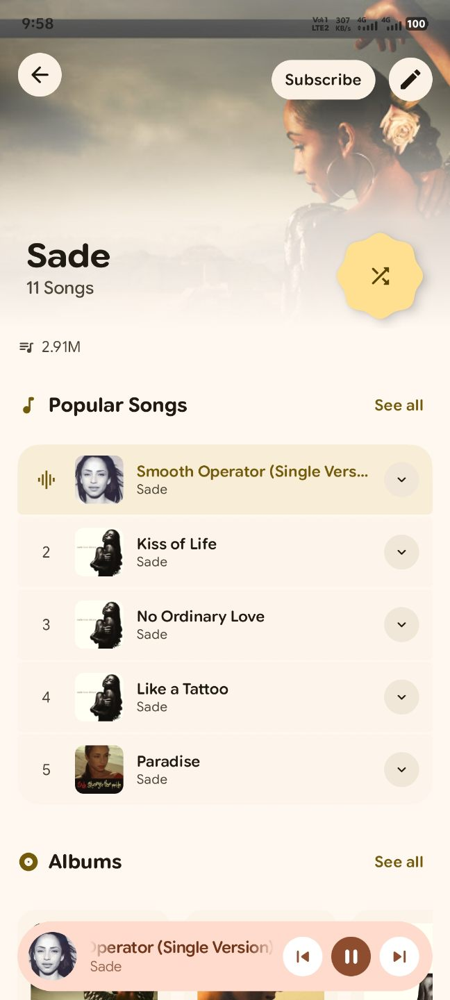

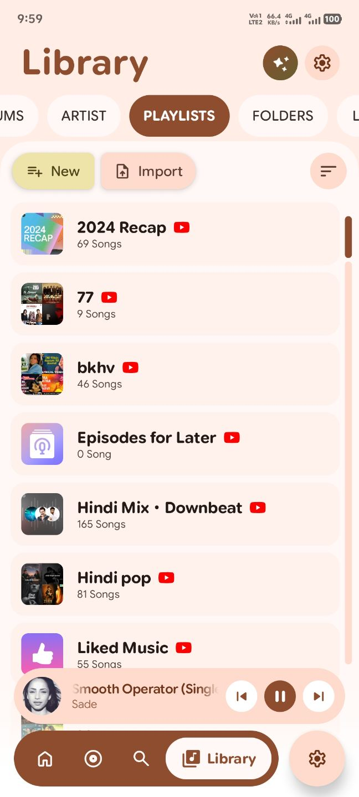

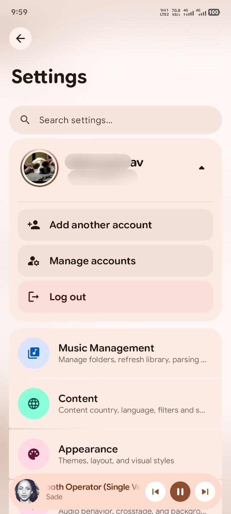

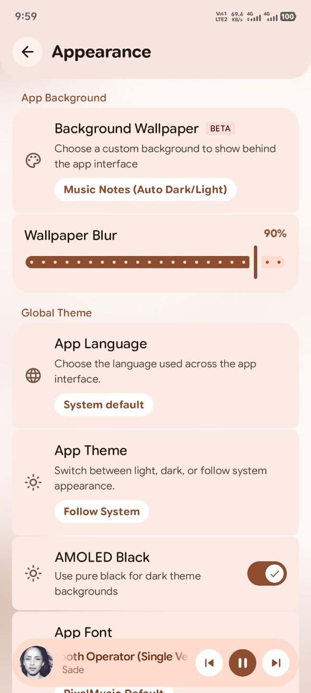

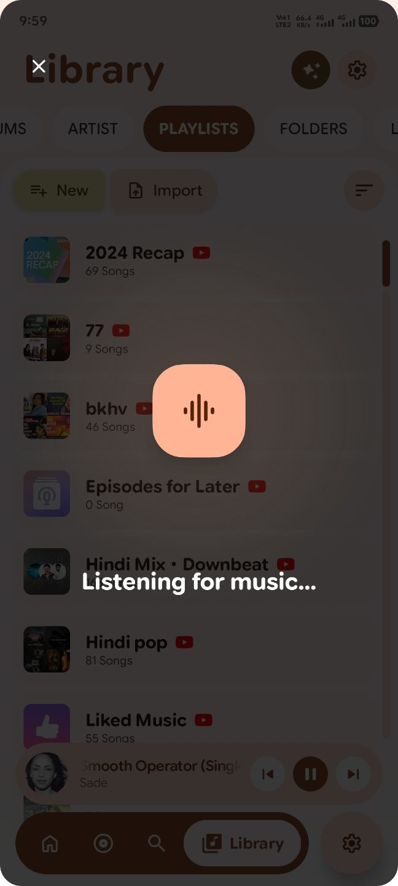

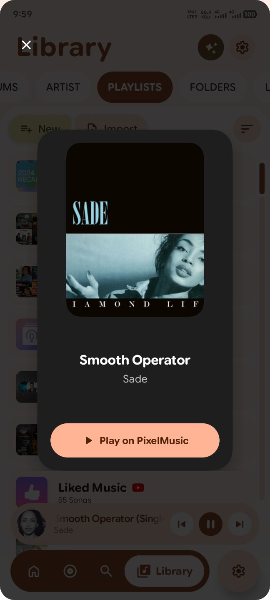

---

## 💎 Signature Features

### ⚡ Direct CDN Streaming Engine

- **Zero HTTP 403 Throttles:** Streams resolve directly to unencrypted GoogleVideo CDN endpoints, bypassing tracking layers and avoiding playback stalls.
- **Adaptive Bitrate Profiles:** Dynamic switching between high-fidelity Opus (up to 160 kbps) and AAC/M4A profiles tailored to network conditions.
- **DualPlayer Preload Architecture:** Pre-buffers adjacent queue tracks in the background for zero-latency, gapless track transitions.
- **Live Audio Telemetry:** Real-time playback stats display itag format, bitrate, sample frequency, and codec details.

### 🎨 Material 3 Expressive Aesthetics

- **Harmonic Dynamic Theming:** Fully responsive color palettes extracted synchronously from active album artwork and your device wallpaper.
- **Fluid AGSL Shaders:** Android 13+ GPU-accelerated motion blur, luminous fog scrim headers, and tactile spring physics.
- **Ambient Profile Ring:** Animated flowing sweep gradient avatar ring responding to system accent colors.
- **Expressive Badges & Controls:** 12-lobed scalloped indicators, customizable navigation bar radius, and haptic feedback.

### 🎤 Synchronized Lyrics & AI Rescue

- **Karaoke Syllable Glow:** Timestamped `.lrc` real-time lyric scrolling with fluid line highlighting.
- **🤖 Gemini AI Lyric Rescue:** Automated AI lyric generation fallback when official sources lack lyrics for rare or indie tracks.
- **Smart Title Sanitizer:** Cleans remasters, feature tags, and bracket noise to guarantee high lyric match rates.
- **Immersive Typography Mode:** Full-screen artist photo background with customizable typographic scaling.

### 💾 Multi-Threaded Chunk Downloader

- **Parallel Byte-Range Engine:** Multi-connection chunk downloader with HTTP 206 byte resume to prevent dropped downloads.
- **Lossless Tag Embedding:** Embeds title, artist, album, release year, genre, and high-resolution cover art directly into audio containers via TagLib & JAudioTagger.
- **Offline `.lrc` Integration:** Injects synchronized lyrics into downloaded files for playback across third-party media apps.
- **MediaStore Auto-Sync:** Instant indexation in Android system-wide media library.

### ☁️ Multi-Cloud & Self-Hosted Sync

- **Subsonic API Protocol:** Direct integration with self-hosted music servers including Navidrome, Airsonic, and Funkwhale.
- **YouTube Music Synchronization:** Seamlessly sync playlists, liked songs, history, and artist subscriptions with bi-directional cloud actions.
- **NetEase Music Cloud:** Access NetEase playlists, charts, and recommendations.
- **Accidental Deletion Safeguards:** Confirmation safeguards for deleting custom playlists and tracks.

### 🏝️ System Capsules & Smart OEM Integrations

- **Status Bar Capsule (Dynamic Island):** Native status bar mini-pill controls on OriginOS, HyperOS, Realme UI, OxygenOS, and ColorOS.
- **Ambient Music Recognition:** Quick Settings tile and floating overlay task to recognize nearby music with haptic confirmation.
- **Android Auto Certified:** Streamlined automotive interface for hands-free driving playback.
- **Share as 30s Video:** Render and export interactive 30-second video cards with audio and artwork to share on social media.

---

## 📥 Get PixelMusic

### Choose your preferred distribution channel:

- 🌐 **[Official Website](https://pixelmusic.pages.dev)** — Direct browser install · ⚡⚡⚡ High-Speed · Direct APK download, latest stable release notes, clean web installer
- 🤖 **[@PixelMusicAppBot](https://t.me/PixelMusicAppBot)** — Instant Telegram delivery & Feedback · ⚡⚡⚡ Instant · Direct in-chat APK delivery, bleeding-edge beta builds, instant update alerts, direct feedback submission

#### 📲 How to Install:

1. Tap either **[pixelmusic.pages.dev](https://pixelmusic.pages.dev)** or open **[@PixelMusicAppBot](https://t.me/PixelMusicAppBot)** on Telegram (which also accepts feedback and bug reports).
2. Download the latest `.apk` installer file.
3. Open the downloaded file and tap **Install** *(if prompted, grant "Install unknown apps" permission to your browser or Telegram)*.
4. Launch **PixelMusic** and enjoy ad-free, high-fidelity music!

> **💡 Zero-Fuss Updates:** Once installed, PixelMusic includes a built-in auto-updater with SemVer checks and changelog previews. You can update seamlessly with a single tap inside the app!

---

## 🛠️ Technology Stack

- **Core Language:** 100% [Kotlin](https://kotlinlang.org/) with Coroutines & Flow
- **UI Engine:** [Jetpack Compose](https://developer.android.com/jetpack/compose) with Material 3 Expressive Design System
- **Audio & Media:** [AndroidX Media3](https://developer.android.com/media/media3) (ExoPlayer, MediaSession, Transformer)
- **Dependency Injection:** [Dagger Hilt](https://dagger.dev/hilt/)
- **Persistence:** [AndroidX Room Database](https://developer.android.com/training/data-storage/room) & Jetpack DataStore
- **Networking:** [OkHttp 5](https://square.github.io/okhttp/) & [Ktor Client](https://ktor.io/)
- **Metadata & Audio Containers:** [TagLib](https://taglib.org/) & [JAudioTagger](http://www.jthink.net/jaudiotagger/)
- **Image Pipeline:** [Coil 3](https://coil-kt.github.io/coil/) with Compose Subcomposition

---

## 👥 Contributors & Credits

- **Lead Developer** — **Saurav Biswas** — [@Saurav124x](https://t.me/Saurav124x) • [GitHub](https://github.com/Saurav-02) • [Instagram](https://www.instagram.com/holy_saurav)
- **UI Design Collaborator** — **@Xyg901** — [@Xyg901](https://t.me/Xyg901)
- **Foundational Architecture** — Built upon and inspired by **PixelPlayer** created by Theo Vilardo — Open Source Community

---

### Join the Community & Help Shape the Future of PixelMusic

*PixelMusic is an open-source project created for personal and educational purposes. All audio, album art, and artist trademarks remain the intellectual property of their respective copyright holders.*
